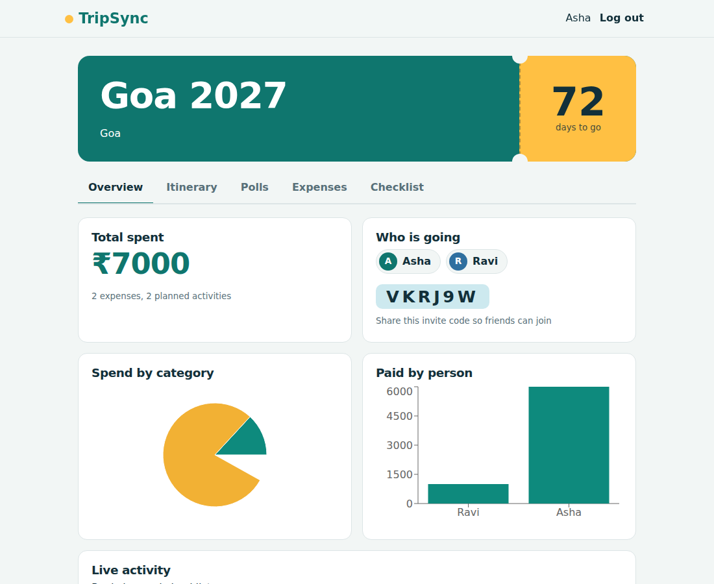
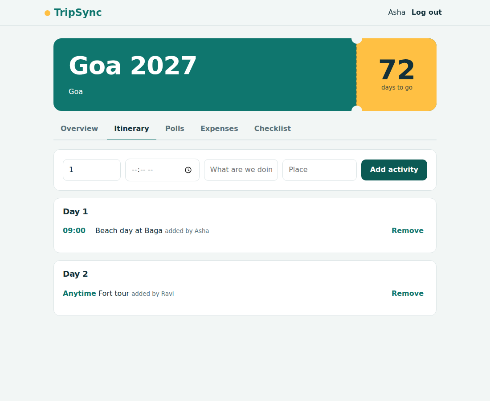
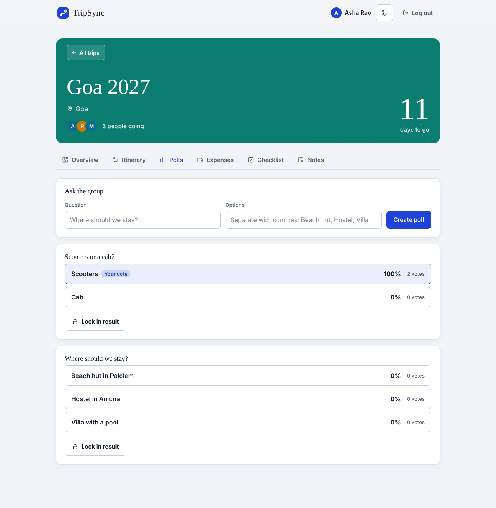
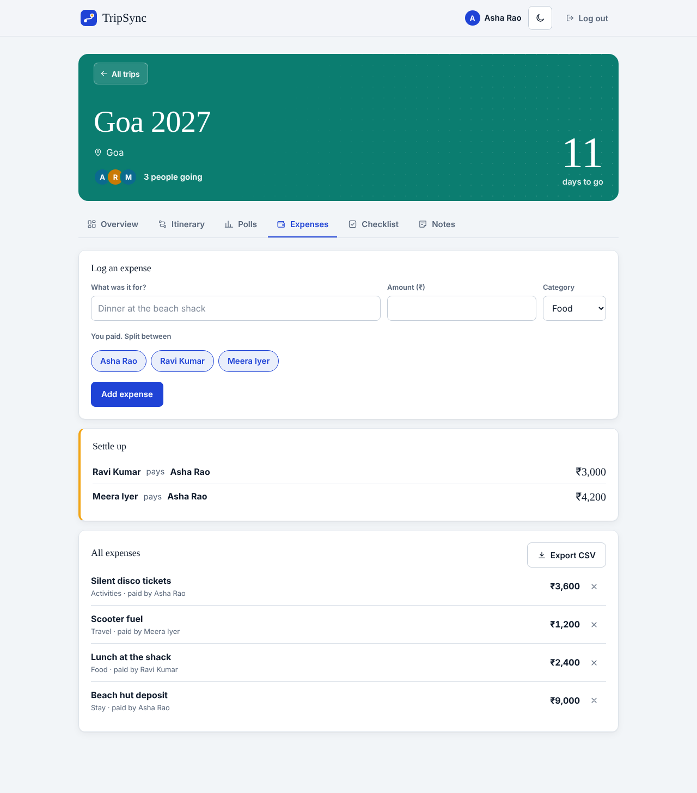
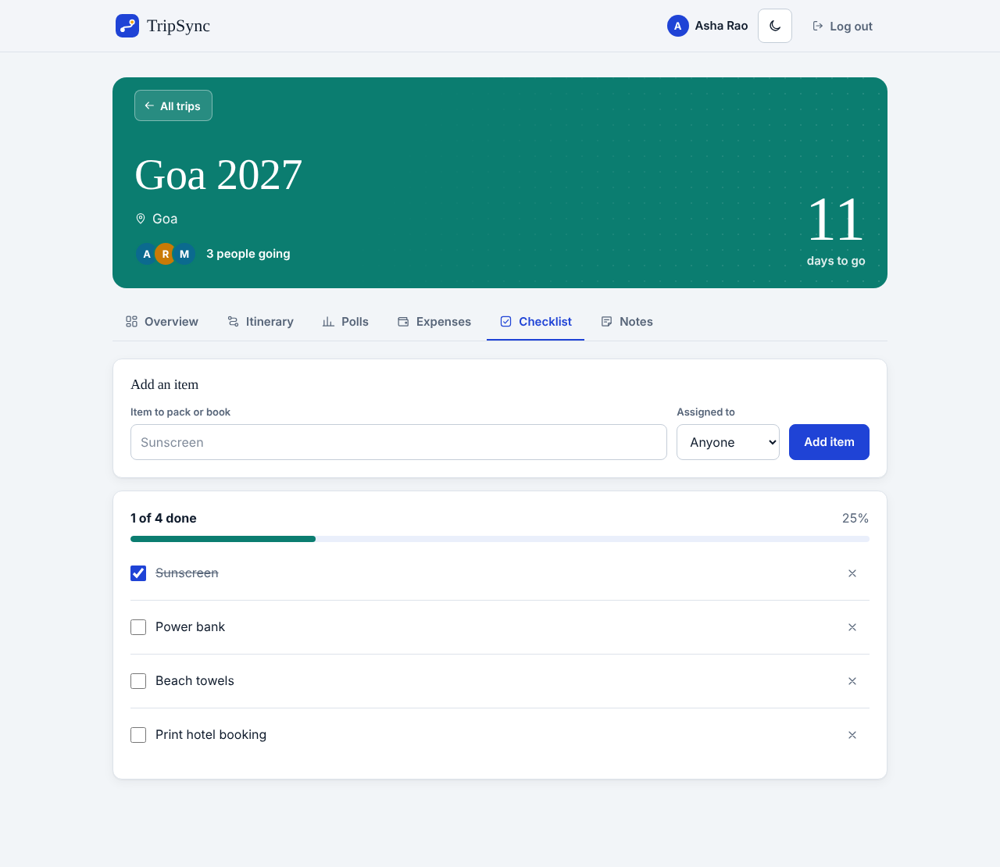
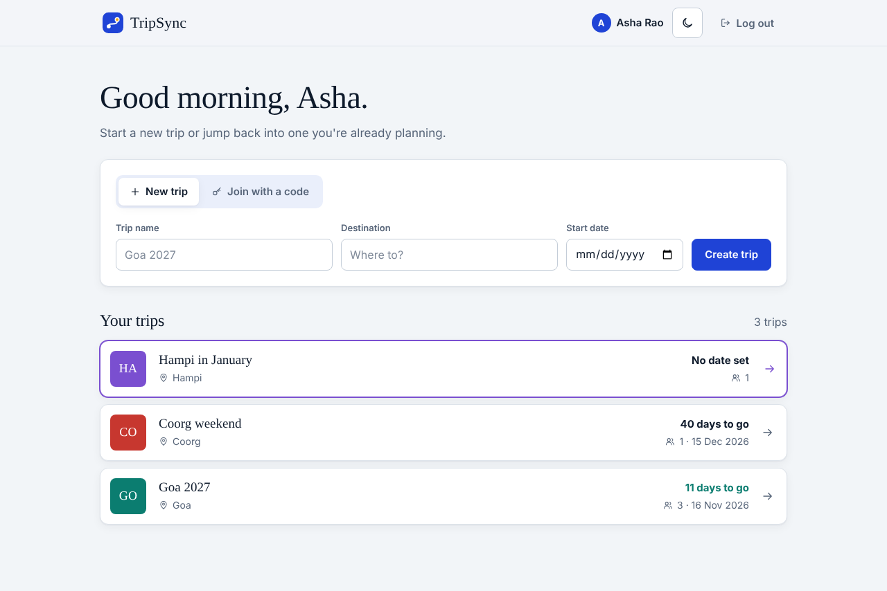
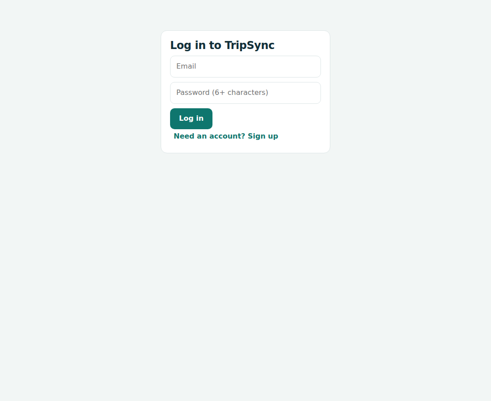

# TripSync

A full-stack web app where a group of friends plans a trip together on one shared, live page: itinerary, polls, expenses and a packing checklist, instead of scattered WhatsApp threads.

Built as a Full Stack Development mini project with **React, Node.js, Express, SQLite and Socket.io**.

## Screenshots

<p align="center">
  
  
</p>
<p align="center">
  
  
</p>
<p align="center">
  
  
</p>
<p align="center">
  
</p>

## Features

- **Accounts:** sign up and log in with JWT authentication; passwords are hashed with bcrypt.
- **Trips and invites:** create a trip and share a 6-letter invite code; friends join with it.
- **Itinerary:** a day-by-day plan that everyone can add to.
- **Polls:** vote on destinations, dates or activities (one vote per person); the trip admin can lock the result.
- **Expense splitter:** log who paid, split between chosen members, and get a settle-up summary of who pays whom.
- **Packing checklist:** shared items that can be assigned to people and ticked off.
- **Dashboard:** total spend, spend by category and by person, a countdown to departure, and a live activity feed.
- **Real-time sync:** when one person changes anything, everyone else's screen updates instantly (Socket.io).

## Tech stack

| Layer | Technology |
| --- | --- |
| Frontend | React 18, Vite, Recharts, plain CSS |
| Backend | Node.js, Express 5, JSON Web Tokens, bcryptjs |
| Database | SQLite (better-sqlite3), a single file created automatically |
| Real-time | Socket.io (one room per trip, authenticated with the JWT) |

## How it works

```
React (Vite)  --REST /api-->  Express  -->  SQLite (tripsync.db)
      ^                          |
      +----- Socket.io <---------+   server emits "update" to the trip room,
                                     clients refetch the trip
```

## Project structure

```
tripsync/
├── client/                 React frontend
│   ├── index.html
│   ├── vite.config.js      dev proxy to the API
│   └── src/
│       ├── main.jsx        entry point
│       ├── App.jsx         login, signup, trip list
│       ├── Trip.jsx        trip page: dashboard, itinerary, polls, expenses, checklist
│       ├── api.js          fetch helper that adds the JWT
│       └── styles.css
├── server/                 Express API
│   ├── index.js            app setup, Socket.io, error handler
│   ├── db.js               SQLite connection and table definitions
│   ├── auth.js             register, login, requireAuth middleware
│   ├── trips.js            trips, activities, polls, expenses, checklist, settle-up
│   └── .env.example
├── docs/
│   ├── screenshots/
│   └── VIVA_NOTES.md
├── LICENSE
└── README.md
```

## Getting started

**Prerequisite:** Node.js 20 or newer. No database to install.

```bash
git clone https://github.com/Punith-G/tripsync.git
cd tripsync

# 1. Backend (terminal 1)
cd server
npm install
cp .env.example .env        # Windows CMD: copy .env.example .env
# open .env and set JWT_SECRET to any long random string
npm run dev                 # API on http://localhost:5000

# 2. Frontend (terminal 2)
cd client
npm install
npm run dev                 # app on http://localhost:5173
```

The database file `server/tripsync.db` is created on first run. Delete it to reset all data.

### Environment variables (`server/.env`)

| Variable | Purpose | Default |
| --- | --- | --- |
| `JWT_SECRET` | Secret used to sign login tokens (required) | none |
| `PORT` | API port | `5000` |
| `DB_FILE` | SQLite file path | `tripsync.db` |

## Try the real-time features

Open two browsers (one normal, one incognito) and sign up a different user in each. Create a trip in the first, then join it from the second with the invite code. Add an activity, vote in a poll, log an expense or tick a checklist item and watch the other window update without a refresh.

## API reference

All `/api/trips` routes need the header `Authorization: Bearer <token>` and only work for members of the trip.

| Method | Route | Description |
| --- | --- | --- |
| POST | `/api/auth/register` | Create an account, returns a token |
| POST | `/api/auth/login` | Log in, returns a token |
| GET | `/api/trips` | List your trips |
| POST | `/api/trips` | Create a trip |
| POST | `/api/trips/join` | Join a trip with an invite code |
| GET | `/api/trips/:id` | Full trip data: members, activities, polls, expenses, checklist, settle-up |
| POST / DELETE | `/api/trips/:id/activities[/:cid]` | Add or remove an itinerary activity |
| POST / DELETE | `/api/trips/:id/expenses[/:cid]` | Add or remove an expense |
| POST / PATCH / DELETE | `/api/trips/:id/items[/:cid]` | Add, tick or remove a checklist item |
| POST | `/api/trips/:id/polls` | Create a poll |
| POST | `/api/trips/:id/polls/:pid/vote` | Vote (replaces your previous vote) |
| POST | `/api/trips/:id/polls/:pid/lock` | Lock a poll (admin only) |

## Database

SQLite with foreign keys and `ON DELETE CASCADE`.

```
users ──< members >── trips ──< activities
                        ├──< polls ──< poll_options ──< votes >── users
                        ├──< expenses ──< expense_splits >── users
                        └──< items
```

## Security notes

- Passwords are hashed with bcrypt; tokens expire after 7 days.
- Every trip route checks membership; only the admin can lock polls.
- All SQL uses parameterised queries; multi-row writes run inside transactions.
- Socket connections must present a valid JWT and can only join trips they belong to.
- CORS is open (`*`) for local development; restrict it before deploying.

## Roadmap

- Export the itinerary as PDF or CSV
- Dark mode
- Trip photo gallery links
- Deploy (Render or Railway for the API, Netlify or Vercel for the client)

## License

MIT, see [LICENSE](LICENSE).
